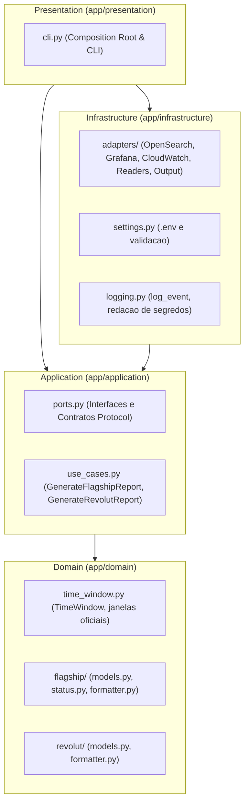

# Regra Arquitetural: DDD e Arquitetura Hexagonal

Esta regra define os limites, contratos e fluxos de dependencia inegociaveis do projeto de Relatorios de Observabilidade.

---

## 1. Topologia das Camadas

---

## 2. Invariantes de Dependencia

1. **Isolamento Absoluto do Nucleo**:
   - `domain` e `application` **nunca** importam modulos de `infrastructure` nem de `presentation`.
   - `domain` contem apenas logica de negocio pura: entidades imutaveis, calculo de janelas temporais, avaliacao de status de ambiente (`evaluate_prd_status`, `evaluate_hml_status`) e formatadores textuais canonicos.
   - O dominio nao possui conhecimento de HTTP, bibliotecas externas (`httpx`, `playwright`), arquivos em disco ou variaveis de ambiente.

2. **Contratos Invertidos (Ports & Adapters)**:
   - Todo acesso ao mundo exterior (OpenSearch Dashboards, Grafana HTTP API, CloudWatch Headless Scraper, stdout) e mediado por contratos (`typing.Protocol`) definidos exclusivamente em `app/application/ports.py`:
     - `FlagshipMetricsReader`
     - `RdsMetricsReader`
     - `RevolutMetricsReader`
     - `ReportOutputPort`
   - Os adaptadores em `app/infrastructure/adapters/` implementam esses protocolos.
   - Os casos de uso recebem as portas injetadas no construtor via `__init__`, viabilizando testes unitarios puros com fakes ou mocks leves.

3. **Composition Root Concentrado**:
   - O ponto onde todos os adaptadores concretos sao instanciados e conectados aos casos de uso reside unica e exclusivamente na camada de apresentacao:
     - `app/presentation/cli.py` (funcao `build_container` ou ponto de composicao da CLI).

4. **Diretrizes de Qualidade do Codigo**:
   - **Zero comentarios**: O codigo de aplicacao deve ser autoexplicativo atraves de nomenclatura expressiva de classes, metodos e variaveis.
   - **Tipagem Estrita**: Todos os metodos e funcoes devem possuir anotacoes de tipo completas em conformidade com o `mypy --strict`.
   - **Limite de Complexidade**: Nenhum arquivo em `app/` deve ultrapassar 300 linhas de codigo. Ao se aproximar deste limite, extraia responsabilidades coesas.
