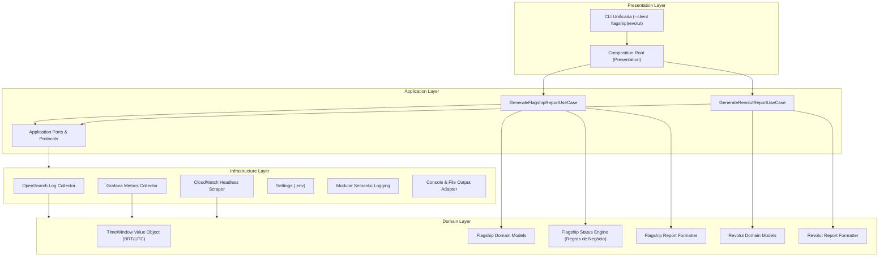

# Relatórios de Observabilidade (Flagship DTW / Revolut MIP)

[](https://github.com/victorhc-silveira-ilegra/matera-relatorios-observabilidade/actions/workflows/ci.yml)
[](https://github.com/victorhc-silveira-ilegra/matera-relatorios-observabilidade/releases)
[](https://www.python.org/downloads/)
[](pyproject.toml)
[](https://docs.astral.sh/ruff/)
[](https://mypy-lang.org/)
[](https://pre-commit.com/)
[](https://www.conventionalcommits.org/)
[](https://semantic-release.gitbook.io/)
[](docs/arquitetura.md)

Sistema determinístico e automatizado para coleta de telemetria, consolidação analítica e geração de relatórios diários de observabilidade e saúde de infraestrutura para os clientes **Flagship (DTW)** e **Revolut (MIP)**.

---

## Visão Geral da Arquitetura

O sistema é construído estritamente sobre os princípios de **Domain-Driven Design (DDD)** e **Arquitetura Hexagonal (Ports & Adapters)**, garantindo que o núcleo de regras de negócio permaneça 100% puro, desacoplado de protocolos de rede e bibliotecas de infraestrutura:



---

## Características Principais

- **Cliente Flagship (DTW)**:
  - Extração de distribuição de logs em OpenSearch para Homologação (`HML`) e Produção (`PRD`).
  - Monitoramento de incidentes em janela pontual `[30m]` (Painel 6 de `OCgyltPVk`), HML incidentes em `[5h]` e restarts em `[6h]`.
  - Regra determinística de status: SAGA com `total < 10` e `acima_5m == 0` permanece estável (`🟢`); Polling com `total < 100` é estável (`🟢`).
  - Coleta opcional de consumo de CPU de instâncias RDS Aurora via automação headless Playwright sobre dashboard público da AWS (com suporte a `--skip-rds`).
- **Cliente Revolut (MIP)**:
  - Consulta ao Grafana corporativo via proxy HTTP dedicado (`10.150.8.18:3128`).
  - Apuração de latências PIX Pagador (P50 <= 0.9s, P95 <= 1.5s) e Recebedor (P50 <= 1.4s, P95 <= 2.3s).
  - Gatilho progressivo para 12 serviços SPI: análise em janela `[15m]`, refinando para `[5m]` e `[1m]` em caso de anomalia para validar normalização recente.
- **Qualidade e Cobertura 100% Inegociáveis**:
  - Matriz de 5 estágios: `Lint` -> `Security` -> `Test` (100% branch coverage) -> `Validate` -> `Build`.
  - Tipagem estrita com `mypy --strict`, linter unificado `ruff`, auditoria SAST com `bandit` e `pip-audit`.
  - Teto rígido de no máximo 300 linhas por arquivo e ausência de comentários em arquivos Python de código e testes.
- **Cadeia Completa de Horários Oficiais (BRT)**:
  - Manhã (`08:30–10:30`), Meio-dia (`10:30–13:30`), Tarde (`13:30–16:30`), detecção automática pelo relógio e execução sequencial da cadeia diária completa.

---

## Instalação e Configuração

### Pré-requisitos

- Python 3.13 ou superior
- Git e Node.js 20+ (para hooks locais de Commitlint)

### Inicialização do Ambiente

```bash
# Clone e crie o ambiente .env local
cp .env.example .env

# Bootstrap completo (venv + dependencias + git-hooks)
make app-setup
```

### Principais Variáveis de Ambiente (`.env`)

| Variável | Descrição | Exemplo |
| :--- | :--- | :--- |
| `KIBANA_HML_USER` / `PASS` | Credenciais OpenSearch HML | `usuario_hml` |
| `KIBANA_PRD_USER` / `PASS` | Credenciais OpenSearch PRD | `usuario_prd` |
| `GRAFANA_DEFAULT_USER` / `PASS` | Credenciais Grafana Flagship | `usuario_grafana` |
| `GRAFANA_REVOLUT_USER` / `PASS` | Credenciais Grafana Revolut | `usuario_revolut` |
| `REVOLUT_HTTP_PROXY` | Proxy HTTP corporativo para rede Revolut | `http://10.150.8.18:3128` |
| `CLOUDWATCH_RDS_URL` | URL pública do dashboard CloudWatch RDS | `https://cloudwatch.amazonaws.com/...` |

---

## Comandos Operacionais (`Makefile`)

O projeto dispõe de uma interface completa via `make`:

```bash
# Ajuda operacional interativa (com menu colorido ANSI)
make help

# ----------------------------------------------------------------------
# Cadeia de Horários - Flagship (DTW)
# ----------------------------------------------------------------------
make report-flagship-10:30    # Janela Manhã (08:30–10:30) (alias: report-flagship-1030)
make report-flagship-13:30    # Janela Meio-dia (10:30–13:30) (alias: report-flagship-1330)
make report-flagship-16:30    # Janela Tarde (13:30–16:30) (alias: report-flagship-1630)
make report-flagship-fast     # Execução rápida (bypass RDS via --skip-rds)
make report-flagship-auto     # Detecta automaticamente a janela pelo relógio
make report-flagship-all      # Executa sequencialmente toda a cadeia do dia

# ----------------------------------------------------------------------
# Cadeia de Horários - Revolut (MIP)
# ----------------------------------------------------------------------
make report-revolut-10:30     # Janela Manhã (08:30–10:30) (alias: report-revolut-1030)
make report-revolut-13:30     # Janela Meio-dia (10:30–13:30) (alias: report-revolut-1330)
make report-revolut-16:30     # Janela Tarde (13:30–16:30) (alias: report-revolut-1630)
make report-revolut-auto      # Detecta automaticamente a janela pelo relógio
make report-revolut-all       # Executa sequencialmente toda a cadeia do dia

# ----------------------------------------------------------------------
# Fechamento Diário Consolidado
# ----------------------------------------------------------------------
make report-all               # Executa toda a cadeia diária de Flagship e Revolut

# ----------------------------------------------------------------------
# Matriz de Qualidade & CI/CD (App / Código)
# ----------------------------------------------------------------------
make app-quality              # Executa a Matriz de 5 Estágios (ou make app-ci)
make app-lint                 # Ruff check, format, Mypy strict e Vulture
make app-security             # Bandit SAST e Pip-Audit contra CVEs
make app-test                 # Pytest com 100% de branch coverage (ou make app-tests)
make app-validate             # Validação estrutural de arquivos e teto de linhas
make app-build                # Empacotamento de pacote wheel
make app-format               # Auto-formatação com Ruff
make app-pre-commit-run       # Executa todos os hooks do pre-commit
make app-clean                # Limpeza de artefatos temporários e caches
```

---

## Documentação Técnica e Governança

- **Harness de Agentes Inteligentes**: Diretrizes e contratos para agentes e LLMs em [.agents/](.agents/) e [AGENTS.md](AGENTS.md).
- **Catálogo de Workflows**: Especificação técnica de CI/CD e composite actions em [.github/workflows.md](.github/workflows.md).
- **Linters e Git Hooks**: Especificação de Conventional Commits com escopo obrigatório (`<tipo>(<escopo>): <descrição>`) e hooks de qualidade em [linters/README.md](linters/README.md).
- **Manual de Arquitetura e Guias**: Índice completo em [docs/README.md](docs/README.md).
