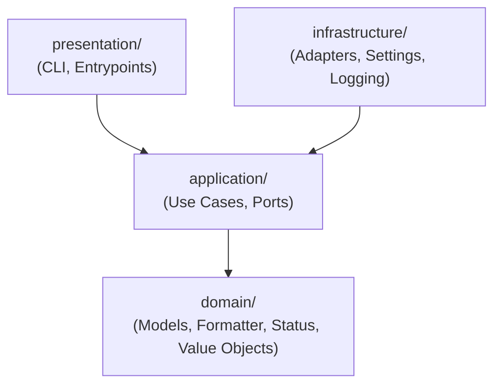

# Codigo-Fonte da Aplicacao (app/)

Estrutura de codigo-fonte organizada segundo os principios da **Arquitetura Hexagonal (Ports & Adapters)** e **Domain-Driven Design (DDD)**.

---

## 1. Regra de Dependencia e Camadas

A regra fundamental de dependencia flui exclusivamente para dentro: detalhes de infraestrutura e apresentacao dependem de abstracoes e casos de uso da aplicacao; o dominio e totalmente isolado e puro.

---

## 2. Detalhamento dos Modulos

1. **[domain/](domain/)**:
   - Camada mais interna e pura do sistema.
   - Contem value objects imutaveis (`TimeWindow`), modelos de dominio (`FlagshipModels`, `RevolutModels`), motores de regra de negocio (`FlagshipStatus`) e formatadores canônicos.
   - Proibicao estrita de chamadas de I/O, imports de infraestrutura ou emissao de logs nesta camada.
2. **[application/](application/)**:
   - Casos de uso (`GenerateFlagshipReportUseCase`, `GenerateRevolutReportUseCase`).
   - Contratos de interface e protocolos abstratos em `ports.py` (`typing.Protocol`).
3. **[infrastructure/](infrastructure/)**:
   - Implementacoes concretas das portas:
     - `adapters/`: coletores HTTP para OpenSearch e Grafana, leitor headless Playwright para CloudWatch e formatador de console/arquivo.
     - `settings.py`: carregamento e validacao rigorosa das variaveis de ambiente do `.env`.
     - `logging/`: pacote modular de logging semantico estruturado (`events.py`, `redact.py`, `emit.py`, `formatters.py`).
4. **[presentation/](presentation/)**:
   - Ponto de entrada executavel da CLI unificada (`cli.py`).
   - Composition root responsavel pela instanciacao e injecao de dependencias nas portas da aplicacao.

Para detalhes completos de arquitetura e diagramas, consulte [docs/arquitetura.md](../docs/arquitetura.md).
