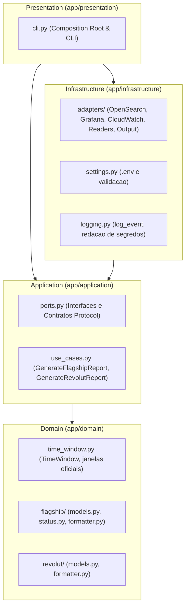

# Manual de Arquitetura do Sistema

O projeto adota Domain-Driven Design (DDD) e Arquitetura Hexagonal (Ports & Adapters), estruturado em quatro camadas logicas com fluxo de dependencia estritamente unidirecional para o nucleo.

---

## 1. Topologia das Camadas

### Camadas e Responsabilidades

1. **Domain (`app/domain`)**:
   - Modelos de dados imutaveis (`dataclass(frozen=True)`).
   - Objeto de valor `TimeWindow` e resolucao das janelas oficiais do fuso `America/Sao_Paulo`.
   - Motor de classificacao de saude (`evaluate_prd_status`, `evaluate_hml_status`) e limiares operacionais deterministas.
   - Formatadores canonicos dos relatorios (`format_flagship_report`, `format_revolut_report`).
   - Isolamento total de I/O, rede, subprocessos e telemetria.

2. **Application (`app/application`)**:
   - Casos de uso (`GenerateFlagshipReportUseCase`, `GenerateRevolutReportUseCase`) orquestrando a extracao e montagem dos dados.
   - Contratos abstratos (`Ports`) definidos via `typing.Protocol` para leitura de metricas e envio do relatorio.

3. **Infrastructure (`app/infrastructure`)**:
   - Implementacoes concretas dos adaptadores de I/O:
     - `OpenSearchClient`: Consultas de agregacao de logs no OpenSearch Dashboards (HML e PRD).
     - `GrafanaClient`: Consultas PromQL e MySQL contra Grafana, com suporte a proxies HTTP.
     - `CloudWatchRdsAdapter`: Extracao de metricas de CPU de instancias RDS via scraping headless (Playwright).
     - `FlagshipMetricsReader` e `RevolutMetricsReader`: Adaptadores compostos que orquestram leituras heterogeneas.
     - `OutputPort`: Publicacao dos relatorios gerados no `stdout` ou persistencia em arquivo.
   - Carregamento de configuracoes e variaveis de ambiente (`Settings`).
   - Logging semantico sanitizado (`log_event`).

4. **Presentation (`app/presentation`)**:
   - Ponto de entrada CLI (`cli.py`).
   - Composition root responsavel pela instanciacao e injecao de dependencias.

---

## 2. Invariantes Arquiteturais

- O dominio e a aplicacao nunca conhecem a infraestrutura ou ferramentas de apresentacao.
- O codigo de aplicacao nao possui comentarios explicativos; toda a comunicacao de intencao reside na tipagem estrita (`mypy --strict`) e nomenclatura expressiva.
- Cobertura inegociavel de 100% de linhas e ramos (`branch coverage`).
- Limite maximo de 300 linhas de codigo por arquivo em `app/`.
