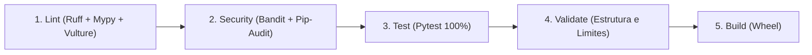

# DevOps, QA, Git Hooks e Matriz de Qualidade

Este documento detalha os estagios de validacao automatizada, ferramentas de QA, linters, git-hooks, governanca de releases e esteira de CI/CD do projeto.

---

## 1. A Matriz de Qualidade (5 Estagios)

O projeto implementa uma esteira deterministica de 5 estagios executada pelo script `scripts/quality_gate.py` (suportando a flag `--stage <estagio>`):



### Detalhamento dos Estagios

1. **Lint**:
   - `ruff check app tests scripts`: Inspeciona estilo, imports e conformidade.
   - `ruff format --check app tests scripts`: Valida consistencia de formatacao.
   - `mypy app tests`: Valida tipagem estrita no modo strict.
   - `vulture --min-confidence 80 app`: Deteccao automatizada de codigo morto.
2. **Security**:
   - `bandit -q -r app`: Analise estatica contra vulnerabilidades de seguranca (SAST).
   - `pip-audit -r requirements.txt`: Auditoria contra vulnerabilidades conhecidas (CVEs) em dependencias.
3. **Test**:
   - `pytest`: Executa a suite de testes estruturada em `tests/unit/` (domain, application, presentation) e `tests/integration/` (infrastructure).
   - Analise de cobertura com `--cov=app --cov-branch --cov-fail-under=100`. Qualquer ramo nao coberto interrompe o pipeline.
4. **Validate**:
   - Valida a presenca de todos os arquivos obrigatorios do Harness de IA, Git, Linters, Releases, Workflows do GitHub Actions, pacote modular de logging e suite de testes segregada.
   - Verifica se nenhum arquivo em `app/` excede 300 linhas de codigo.
5. **Build**:
   - `python -m build --no-isolation --wheel`: Empacota a distribuicao wheel do pacote no diretorio `dist/`.

---

## 2. Git Hooks e Pre-Commit

O projeto utiliza `pre-commit` e `commitlint` para assegurar que nenhum commit quebre a esteira de qualidade ou viole as convencoes do repositorio:

- **Instalacao:** `make app-pre-commit` (ou `bash linters/git-hooks/install.sh`).
- **Hook `commit-msg`:** Executa o `commitlint` via `npx`, garantindo mensagens no padrao Conventional Commits em portugues com **escopo semantico obrigatorio** (`<tipo>(<escopo>): <descricao>`). Mensagens sem escopo sao bloqueadas imediatamente.
- **Escopos Permitidos:** `app`, `application`, `ci`, `deps`, `docs`, `domain`, `flagship`, `harness`, `hooks`, `infra`, `linters`, `makefile`, `presentation`, `release`, `reports`, `revolut`, `scripts`, `tests`.
- **Hook `pre-commit`:** Executa a Matriz de 5 Estagios (`python-lint`, `python-security`, `python-test`, `python-validate`, `python-build`).

---

## 3. Semantic Release

O arquivo `linters/releaserc.json` configura o versionamento continuo e publicacao automatica:
- Analisa commits seguindo o padrao Conventional Commits.
- Gera notas e atualiza `docs/CHANGELOG.md`.
- Atualiza o campo `version` em `pyproject.toml`.
- Gera tags Git correspondentes na branch `main`.

---

## 4. Pipeline de CI/CD (GitHub Actions)

A esteira de automacao remota em nuvem esta estruturada em `.github/workflows/ci.yml` e consome composite actions modulares em `.github/actions/`:

### Estrutura de Jobs e Acoes

| Job | Gatilhos | Composite Action | Responsabilidade |
| :--- | :--- | :--- | :--- |
| `commitlint` | Push, PR | `ci/validate-commitlint` | Valida mensagens de commit seguindo Conventional Commits |
| `python` | Push, PR | `ci/validate-python` | Executa os 5 estagios via `scripts/quality_gate.py` com 100% de cobertura |
| `scripts` | Push, PR | `ci/validate-scripts` | Analisa sintaxe shell (`bash -n`) e alvos do Makefile em dry-run |
| `github` | Push, PR | `ci/validate-github` | Valida sintaxe de workflows com `actionlint` e segredos com `gitleaks` |
| `release` | Push em `main` | `ci/sync-tags` + `ci/release` | Sincroniza tags orfas, gera changelog e publica versao semantica |
| `pipeline-summary` | Push em `main` | `shared/pipeline-summary` | Consolida status de todos os jobs no `GITHUB_STEP_SUMMARY` |

### Controle de Concorrencia e Ignicao

- **Concorrencia:** Cancelamento automatico de builds redundantes na mesma branch/PR via `cancel-in-progress: true`.
- **Skip CD:** Commits contendo `[skip-cd]` ou disparos manuais (`workflow_dispatch`) com `skip_cd: true` omitem a etapa de publicacao de release mantendo todas as validacoes de qualidade ativas.

---

## 5. Comandos Operacionais (Makefile)

O `Makefile` expoe alvos diretos para desenvolvedores, esteiras de automacao e operacao diaria:

```bash
# Ajuda interativa com menu ANSI
make help

# Matriz de Qualidade & CI/CD (Codigo / App)
make app-quality          # Executa todos os 5 estagios da Matriz de Qualidade (ou app-ci)
make app-lint             # Estagio 1: Ruff check, format, Mypy strict e Vulture
make app-security         # Estagio 2: Bandit SAST e Pip-Audit
make app-test             # Estagio 3: Pytest com 100% de branch coverage (ou app-tests)
make app-validate         # Estagio 4: Valida estrutura e limite de linhas
make app-build            # Estagio 5: Empacota a distribuicao wheel

# Ferramentas individuais de QA
make app-format           # Auto-formatacao e fix de imports com Ruff
make app-dead-code        # Deteccao de codigo morto com Vulture
make app-audit            # Auditoria de vulnerabilidades em dependencias

# Gestao de ambiente e git-hooks
make app-setup            # Bootstrap completo: .venv + deps + git-hooks
make app-install          # Instala dependencias no .venv
make app-pre-commit       # Instala hooks locais (ou app-pre-commit-install)
make app-pre-commit-run   # Executa hooks em todos os arquivos
make app-clean            # Limpa caches, builds e artefatos temporarios

# Cadeia Operacional - Flagship (DTW)
make report-flagship WINDOW=10:30-13:30   # Janela configuravel
make report-flagship-10:30                # Janela Manha (08:30–10:30) (alias: report-flagship-1030)
make report-flagship-13:30                # Janela Meio-dia (10:30–13:30) (alias: report-flagship-1330)
make report-flagship-16:30                # Janela Tarde (13:30–16:30) (alias: report-flagship-1630)
make report-flagship-fast                 # Execucao rapida (bypass scraping RDS via --skip-rds)
make report-flagship-auto                 # Deteccao automatica da janela pelo relogio
make report-flagship-all                  # Executa toda a cadeia diaria sequencialmente

# Cadeia Operacional - Revolut (MIP)
make report-revolut WINDOW=10:30-13:30    # Janela configuravel
make report-revolut-10:30                 # Janela Manha (08:30–10:30) (alias: report-revolut-1030)
make report-revolut-13:30                 # Janela Meio-dia (10:30–13:30) (alias: report-revolut-1330)
make report-revolut-16:30                 # Janela Tarde (13:30–16:30) (alias: report-revolut-1630)
make report-revolut-auto                  # Deteccao automatica da janela pelo relogio
make report-revolut-all                   # Executa toda a cadeia diaria sequencialmente

# Execucao Consolidada (Ambos os Clientes)
make report-all                           # Executa toda a cadeia diaria de Flagship e Revolut
```
